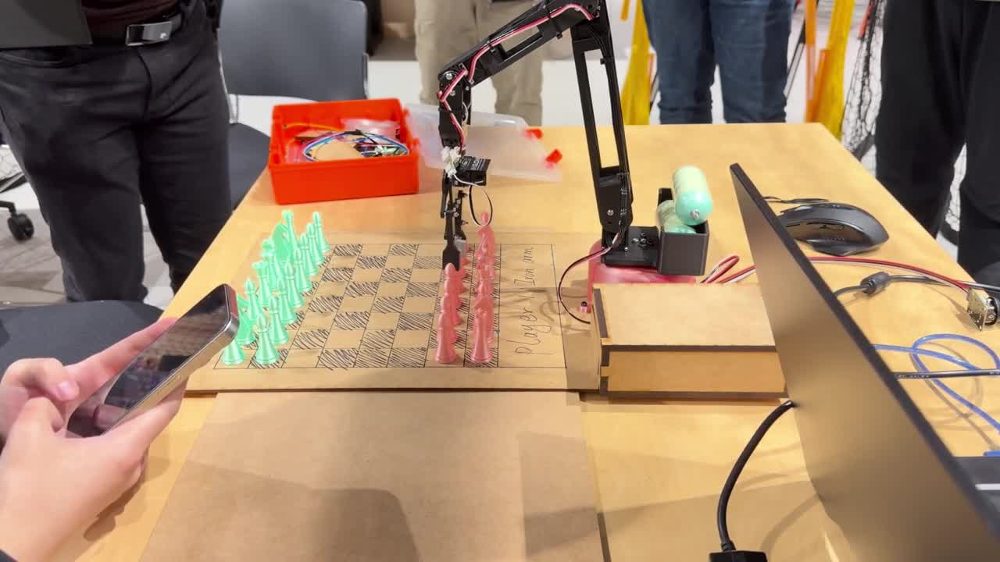
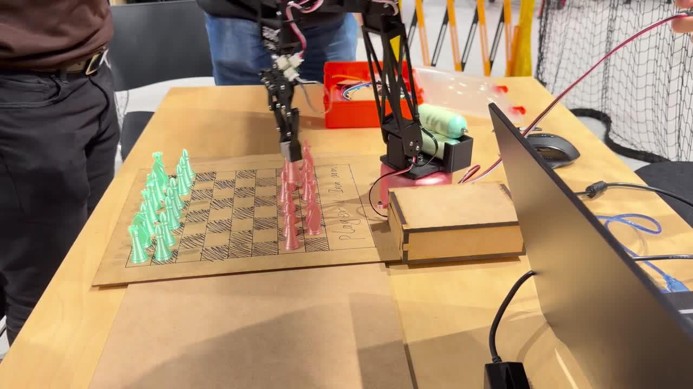
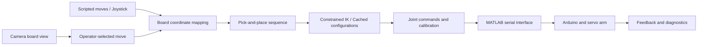
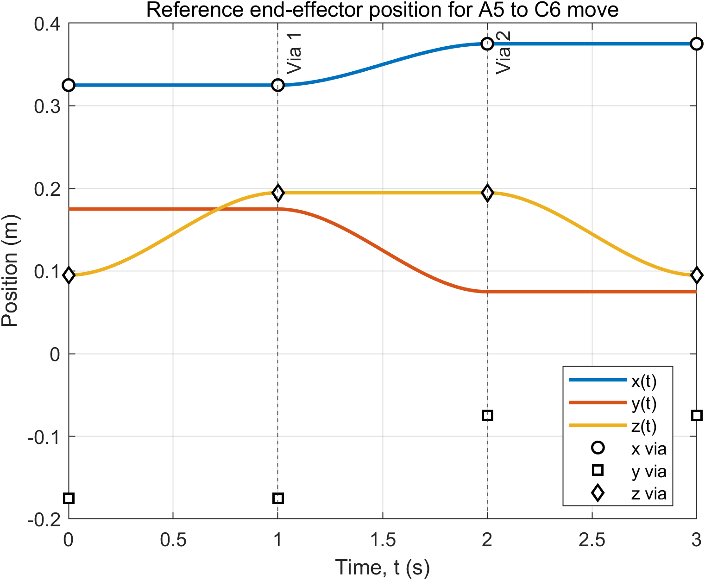
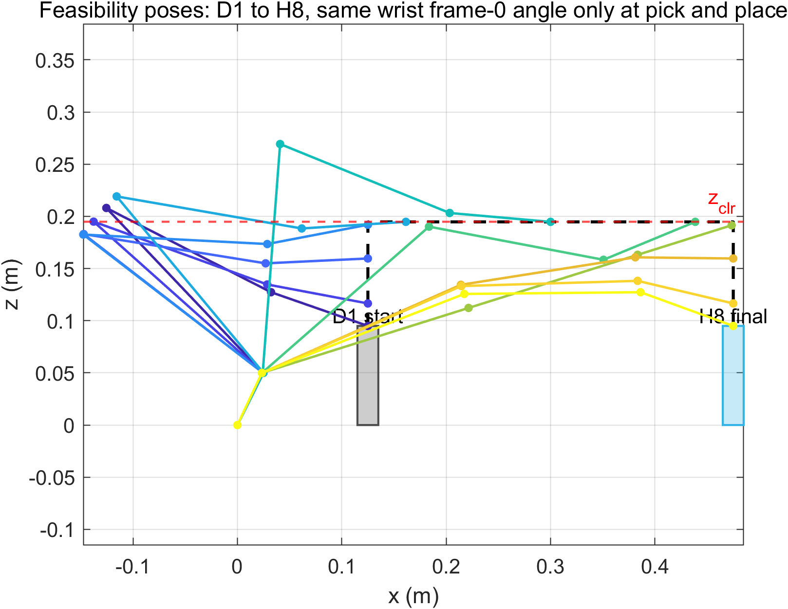

# Robotic Arm — Modeling, Motion Planning & Chess Manipulation

A robotic arm project that connects mathematical modeling, trajectory planning, and physical servo control through a chess pick-and-place application. Developed as a team project for MCEN90028 Robotics Systems, it covers forward kinematics, workspace analysis, Jacobian-based inverse kinematics, and interactive control of an assembled arm.

## Hardware Demo

Short hardware demonstrations show the assembled arm operating over a chessboard. Click a preview to watch the clip.

[](media/demo-01.mp4)

[](media/demo-02.mp4)

## What the Project Implements

- **Kinematics and workspace modeling:** link geometry, zero configurations, forward transformations, and reachable workspace visualization.
- **Jacobian analysis:** symbolic derivation, verification scripts, and torque evaluation outputs.
- **Constrained inverse kinematics:** damped least-squares updates with joint limits, bounded steps, elbow clearance, and wrist-orientation preferences.
- **Chess manipulation:** board-square coordinate mapping and approach, grasp, lift, transfer, and release sequences.
- **Cached motion planning:** precomputed IK configurations for scripted moves, joystick positions, and transfers.
- **Physical-arm control:** serial motor commands, feedback acquisition, zero-offset calibration, and position/velocity control implementations.
- **Operator interfaces:** joystick-assisted manipulation and camera capture/cropping for operator-selected moves.

## System Architecture



The motion module links chessboard targets to joint commands. It handles arm geometry, posture constraints, calibration offsets, and pick-and-place sequencing. Camera tooling provides a board view for an operator to select moves.

## Engineering Approach

**Model the reachable space.** Geometry and coordinate transformations describe the arm; workspace and trajectory plots support inspection of board reachability and planned poses.

**Control posture as well as position.** The IK implementation uses damping, bounded updates, elbow clearance, and wrist-angle constraints to generate configurations suited to piece handling.

**Separate planning from execution.** Precomputation scripts generate reusable configurations, while execution controllers load those configurations for scripted and interactive motion.

**Account for the assembled hardware.** Servo offsets, motor direction settings, board geometry, feedback logs, and tilt-compensation implementations support calibration and control tuning.

## Repository Structure

```text
projects/
  01-kinematics/          Forward kinematics and workspace
  02-jacobian/            Jacobian derivation and verification
  03-path-planning/       URDF models and trajectory simulation
  04-hardware-prototype/  Position-control development
  05-matlab-control/      Serial communication and trajectory tools
  06-chess-robot/         Integrated chess manipulation and interfaces
media/                   Short hardware demos and preview images
docs/                    Setup and configuration notes
archive/                 Earlier modeling and control iterations
```

For a technical review, begin with the [chess movement module](projects/06-chess-robot/matlab/chessMoveModule.m), [IK precomputation](projects/06-chess-robot/matlab/precomputeTask1IK.m), and [joystick controller](projects/06-chess-robot/matlab/runTask2JoystickControl.m). Alternative position/velocity and compensation implementations are retained in `archive/`.

## Simulation Outputs





## Technology Stack

- **Modeling and control:** MATLAB, Robotics System Toolbox, Symbolic Math Toolbox, URDF.
- **Hardware:** Arduino, servo motors, serial communication, joystick.
- **Camera tooling:** Python, Pillow, FFmpeg, Node.js, PowerShell.

## Getting Started

1. Open `projects/01-kinematics/` in MATLAB and run `WorkSpace.m` to explore the modeled workspace.
2. Explore trajectory and URDF scripts in `projects/03-path-planning/`.
3. For physical manipulation, configure the course communication libraries, motor settings, board geometry, servo calibration, and IK caches in `projects/06-chess-robot/`.

See [setup instructions](docs/SETUP.md) for dependencies and hardware configuration. Load one controller variant at a time because implementations share function names.
