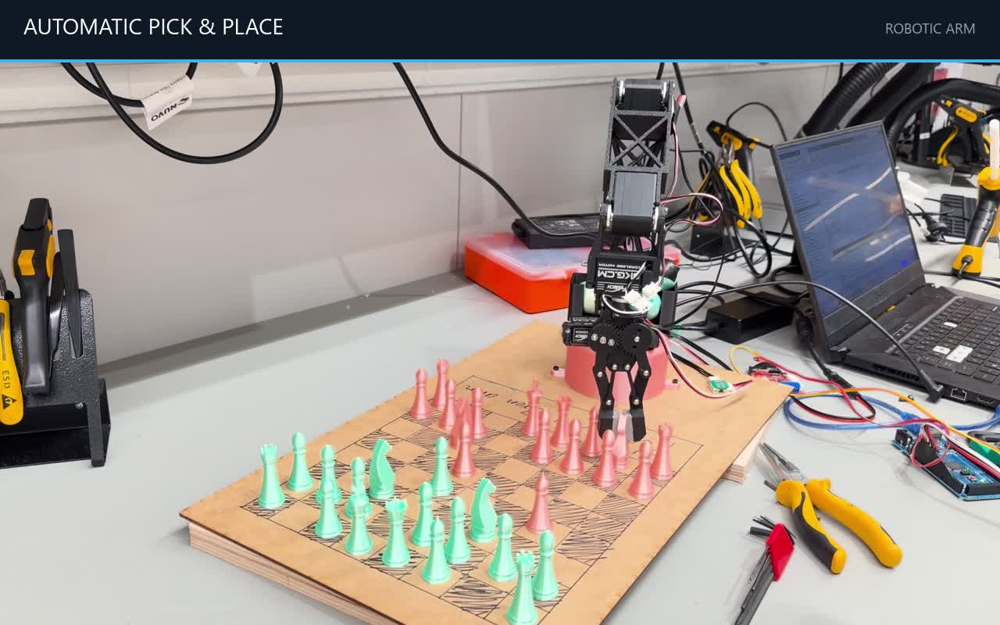
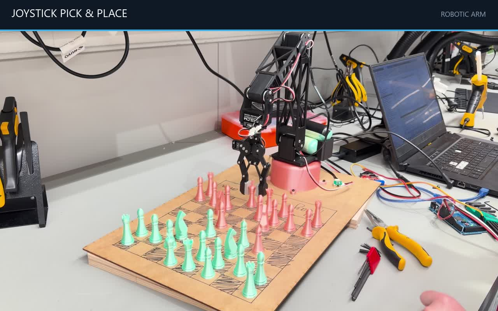
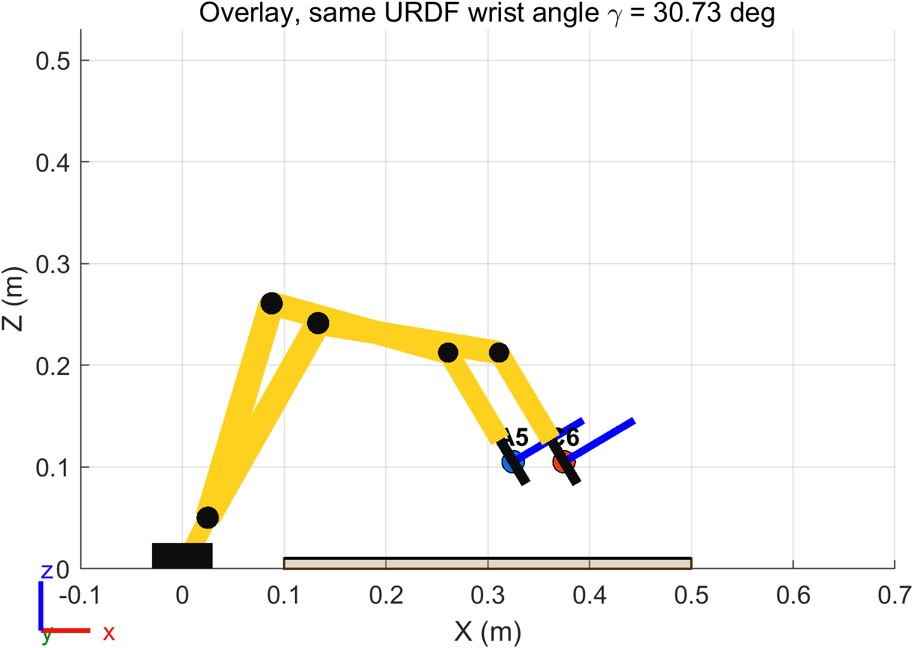
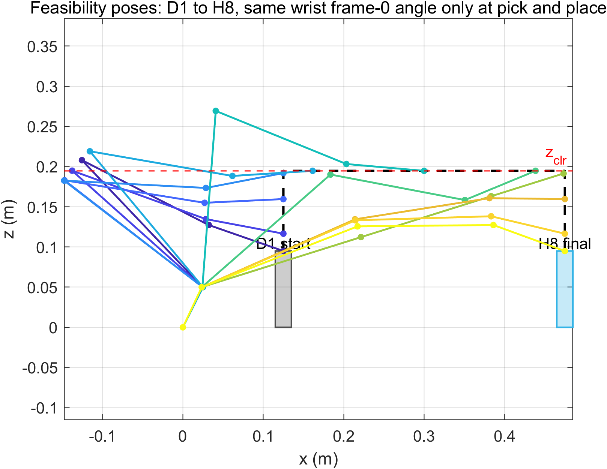
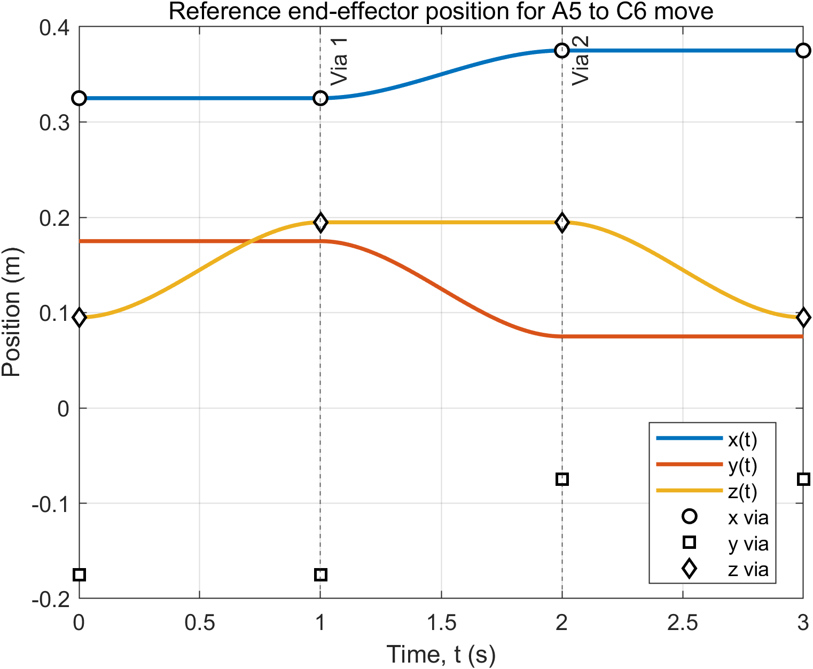
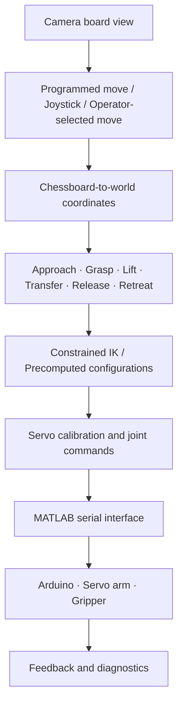

# Robotic Arm | Model-Based Chess Manipulation

**Kinematic Modeling · Constrained Motion Planning · Hardware Integration**

A chess-piece manipulation system connecting kinematic modeling, workspace analysis and trajectory planning with servo calibration, serial communication and physical robot execution.

Developed as a team project at the University of Melbourne for MCEN90028 Robotics Systems. The system translates chessboard targets into executable joint configurations, supporting programmed pick-and-place and joystick-assisted manipulation.

[Hardware demos](#hardware-demonstrations) · [Modeling gallery](#modeling-and-planning-gallery) · [Technical approach](#technical-approach) · [Code map](#code-map) · [Setup](docs/SETUP.md)

## Hardware Demonstrations

### Programmed pick & place

A physical arm coordinates joint motion and gripper actions to transfer chess pieces. **Click the image to watch the demonstration.**

[](media/automatic-pick-and-place.mp4)

### Joystick-assisted manipulation

The operator controls the manipulation workflow through a joystick interface.

[](media/joystick-pick-and-place.mp4)

## Engineering Highlights

| Engineering problem | Implementation | Purpose |
| --- | --- | --- |
| Can the arm reach the board? | DH-based forward kinematics and sampled workspace visualization | Inspect board placement against modeled reachability |
| How should the gripper approach a piece? | Damped least-squares IK, bounded updates, joint limits, elbow clearance and wrist-orientation preferences | Generate useful configurations for grasping and placement |
| How is a chess move executed? | Board-to-world mapping and approach → grasp → lift → transfer → release → retreat sequencing | Turn square-level targets into coordinated manipulation |
| How is planning connected to hardware? | Cached IK configurations, servo offsets, motor directions and MATLAB serial commands | Separate configuration generation from motion execution |
| How can an operator interact? | Programmed sequences, joystick control and camera board-view tooling | Support demonstrations and interactive operation |

## Modeling and Planning Gallery

### 1. Workspace analysis and board placement

The sampled end-effector workspace is visualized together with the chessboard. This supports geometric reachability inspection; a reachable position still needs a feasible grasp posture and transfer path.


[Workspace implementation](projects/01-kinematics/WorkSpace.m)

### 2. URDF-based posture inspection

Robot configurations at two board targets are overlaid with the same modeled wrist angle. The visualization makes the relationship between target location, joint posture and tool orientation explicit.



### 3. Manipulation trajectory and intermediate configurations

Intermediate arm configurations visualize a planned transfer across the board. Cartesian traces show how the end-effector coordinates evolve along the simulated path.





These figures are saved modeling and simulation outputs. The videos above show physical operation; the plots are not presented as measured hardware tracking results.

## System Architecture



Camera tooling supports board viewing and operator-selected moves. It is not described here as autonomous chess recognition or autonomous game playing.

## Technical Approach

### Kinematics and workspace

DH transformations describe the arm geometry and zero configuration. Workspace scripts sample joint configurations and plot the corresponding end-effector positions. Symbolic Jacobian derivation and verification scripts connect joint motion to Cartesian motion and support torque analysis.

### Task-aware inverse kinematics

A Cartesian target alone does not determine a useful grasp posture. The motion module combines damped least-squares updates with bounded steps, joint limits, elbow clearance and wrist preferences. These are configuration constraints and heuristics; they are not a general collision-free planning guarantee.

### Planning and execution

IK precomputation scripts create reusable joint configurations for scripted moves, joystick targets and transfers. Execution routines coordinate arm motion with gripper opening and closing through distinct manipulation stages. Separate controller variants explore position and velocity control.

### Hardware calibration and integration

Servo zero offsets, motor directions, board geometry and feedback tooling connect the mathematical model to the assembled hardware. Alternative compensation and control iterations remain available in the archive for technical review.

## Code Map

| Module | Recommended entry point |
| --- | --- |
| Forward kinematics and workspace | [WorkSpace.m](projects/01-kinematics/WorkSpace.m) |
| Jacobian derivation and verification | [Jacobian_verification.m](projects/02-jacobian/Jacobian_verification.m) |
| URDF trajectory planning | [Path_planning.m](projects/03-path-planning/Path_planning.m) |
| Integrated manipulation and IK | [chessMoveModule.m](projects/06-chess-robot/matlab/chessMoveModule.m) |
| Offline configuration generation | [precomputeTask1IK.m](projects/06-chess-robot/matlab/precomputeTask1IK.m) |
| Joystick manipulation | [runTask2JoystickControl.m](projects/06-chess-robot/matlab/runTask2JoystickControl.m) |
| Command-based control session | [startChessRobotSession.m](projects/06-chess-robot/startChessRobotSession.m) |

```text
projects/
  01-kinematics/          Geometry, forward kinematics and workspace
  02-jacobian/            Jacobian analysis and verification
  03-path-planning/       URDF models and trajectory simulation
  04-hardware-prototype/  Position-control development
  05-matlab-control/      Communication and trajectory tools
  06-chess-robot/         Integrated manipulation and interfaces
media/                   Hardware demonstration videos
docs/                    Setup and technical presentation notes
archive/                 Earlier modeling and control iterations
```

## Technology Stack

**Core:** MATLAB · Robotics System Toolbox · Symbolic Math Toolbox · URDF<br>**Hardware:** Arduino · Servo motors · Gripper · Joystick · Serial communication<br>**Supporting camera tools:** Python/Pillow · FFmpeg · Node.js · PowerShell

## Getting Started

1. Run `projects/01-kinematics/WorkSpace.m` in its MATLAB directory to inspect the workspace.
2. Explore the URDF and trajectory scripts in `projects/03-path-planning/`.
3. For hardware, follow [SETUP.md](docs/SETUP.md), supply the required upstream communication libraries, and configure motor IDs, directions, serial port, board geometry, offsets and IK caches.

Use one controller variant at a time: multiple directories contain functions with the same names. The separate `so101.urdf` requires mesh assets not included here. No new hardware or MATLAB execution was performed during this documentation update.

See [setup and hardware configuration](docs/SETUP.md) for implementation requirements and repository scope.
